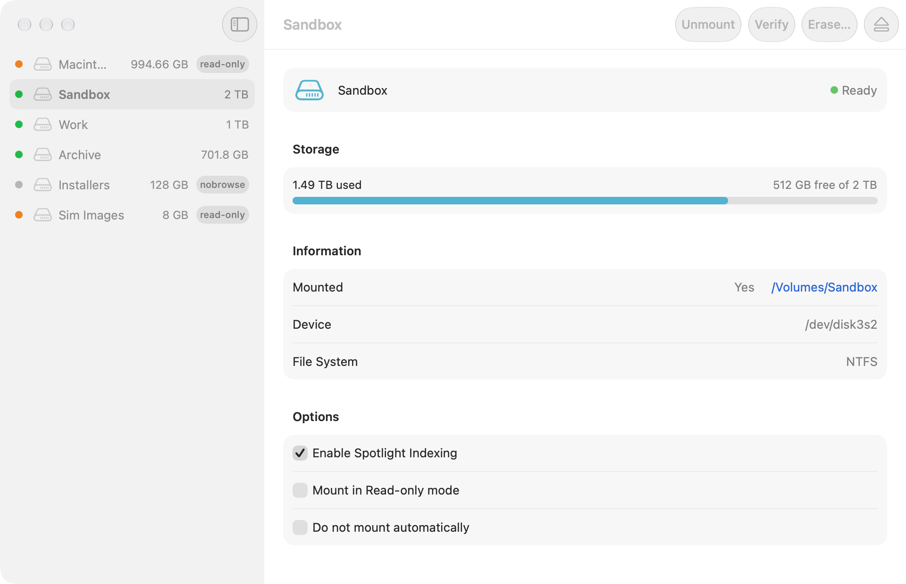
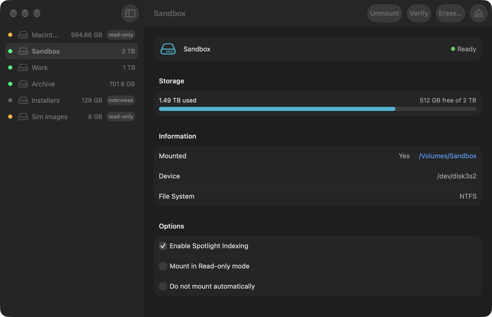

# NTFSSilicon

A native Apple-Silicon volume manager for macOS 26 — see, mount, verify,
rename and format volumes, with a menu-bar extras panel and per-volume
options that are actually enforced. Under the hood it is pure `DiskArbitration` + `diskutil` + whatever
filesystem tools are already installed on the machine.

## Features

- **Sidebar + detail** — one row per volume (status dot, name, size, chips),
  full detail: mount point, device, filesystem, capacity bar.
- **Mount / Unmount / Eject** — from the toolbar (⌘M, ⌘E), the menu-bar
  panel, or a row's context menu. Errors surface inline.
- **Verify** — `diskutil verifyVolume` behind a sheet; disabled for
  read-only media.
- **Rename** — the name field is always editable; Return commits,
  Escape resets.
- **Per-volume options, enforced for real:**
  - *Mount in Read-only mode* → `diskutil mount readOnly`.
  - *Do not mount automatically* → a DiskArbitration mount-approval veto.
    Only while the app runs (see Limits); the app's own explicit Mount
    bypasses it so it never fights the user.
- **Erase** — destructive-action sheet; filesystem choices come from
  probing `/Library/Filesystems/*.fs` at open, so "Microsoft NTFS"
  appears **only** if an NTFS formatter is installed (Paragon's, or any
  other). Never hardcoded to one vendor.
- **Verify-before-mount policy** — optional setting; a failing check
  aborts the mount with the tool's message.
- **Notifications** — optional alerts when volumes mount/unmount
  (DiskArbitration VolumePath watch + UserNotifications).
- **Settings** — accent color, launch at login via `SMAppService`,
  standard ⌘, / About panel.

## Screenshots

| Light | Dark |
|---|---|
|  |  |
|  |  |
|  |  |

Regenerate with `tools/snap.sh`.

## Requirements

- macOS 26+, Apple Silicon, Xcode with the macOS 27 SDK
- No runtime dependencies beyond the system frameworks

## Build

```sh
./build.sh         # builds, signs, installs to ~/Applications, --open relaunches
swift test --scratch-path ~/Library/Developer/NTFSSilicon/test-build
tools/selftest.sh  # real-machine checks (needs APP_STORE=/tmp)
tools/snap.sh      # light+dark screenshots to /tmp/NTFSSilicon-shots
tools/make-dmg.sh  # signed drag-to-install disk image at dist/NTFSSilicon.dmg
```

Two live hardware tests are gated so CI and casual runs stay local-only —
they make and destroy their own throwaway dmg images:

```sh
VETO_TEST=1        swift test …   # veto blocks mount; readOnly mount works
NTFS_ERASE_TEST=1  swift test …   # NTFS erase via installed formatter
```

## Limits (on purpose, not bugs)

- **NTFS writing** depends on whatever filesystem driver/tools the machine
  already has. This app does not and will not ship a kernel NTFS driver.
- **"Do not mount automatically"** is only enforced while the app is
  running; a full system-level veto would need a privileged helper.
- **Notifications** can't observe *failed* mounts — nothing announces
  itself by absence.
- **Verify progress** is indeterminate: `diskutil` exposes no fraction.
- The menu-bar item is always on; SwiftUI's `MenuBarExtra` cannot be
  removed at runtime.

## Layout

- `Sources/NTFSSiliconKit/` — the engine: `VolumeStore` (diskutil verbs,
  tool probing), `VolumeInfo` (parsers), `VolumePrefs` (UUID-keyed options),
  `MountVeto` (DiskArbitration approval callback).
- `Sources/NTFSSilicon/` — SwiftUI app: window, menu-bar panel, settings,
  everything single-source-of-truth from one `AppModel`.
- `docs/STORIES.md` — the story ledger this was built against, statuses
  kept honest. `docs/screens/` (reference app screenshots) is git-ignored.
